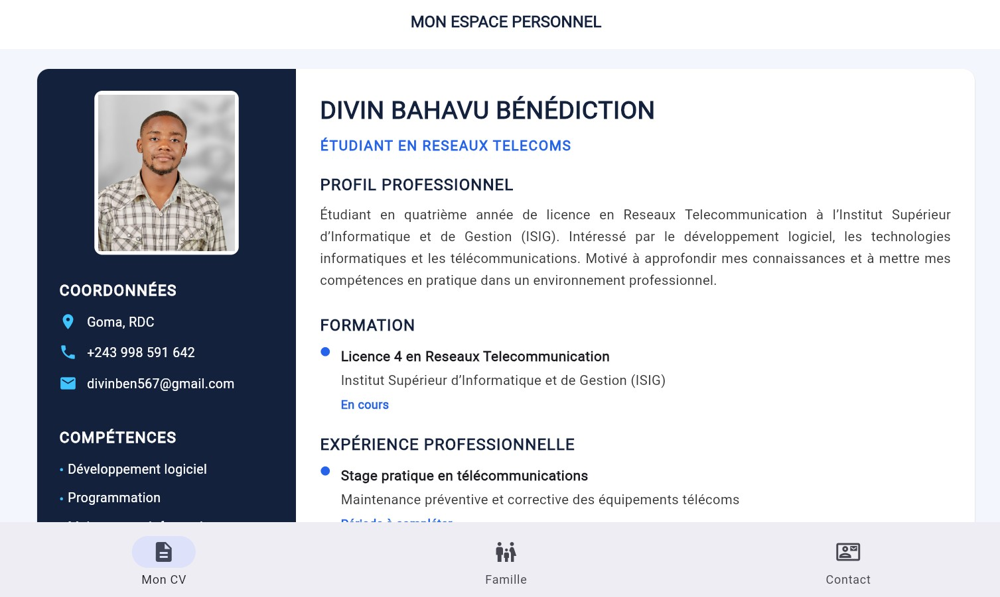
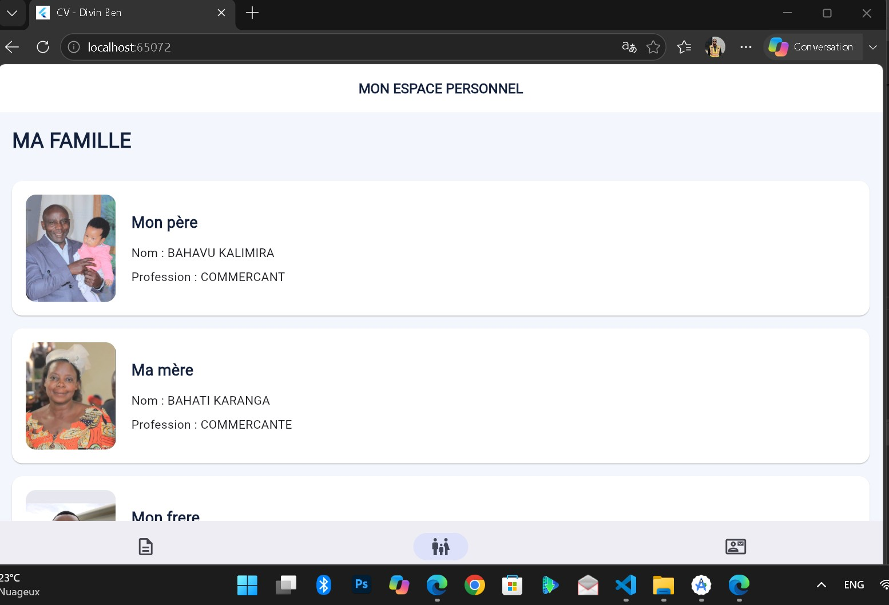

# APPLICATION CV – DIVIN BEN

## Présentation du projet

Bienvenue sur mon projet Flutter de présentation personnelle.

Cette application permet de découvrir mon curriculum vitæ, mes informations personnelles, ma famille ainsi que mes coordonnées.

## Fonctionnalités

- Présentation personnelle
- Consultation de mon CV
- Présentation des membres de ma famille
- Affichage des photos familiales
- Informations de contact
- Interface moderne et navigation simple

##  Technologies utilisées

- Flutter
- Dart
- Visual Studio Code
- Git et GitHub

## Captures d'écran

### 1. Capture 

### 2. Capture 

### 3. Capture 

### 4. Capture 

### 5. video
https://github.com/user-attachments/assets/9233f302-1acc-4e31-a2ab-d0bd357e0716
## 6. Auteur
**DIVIN BAHAVU BÉNÉDICTION**
---
© 2026 DIVIN BEN – Tous droits réservés.
