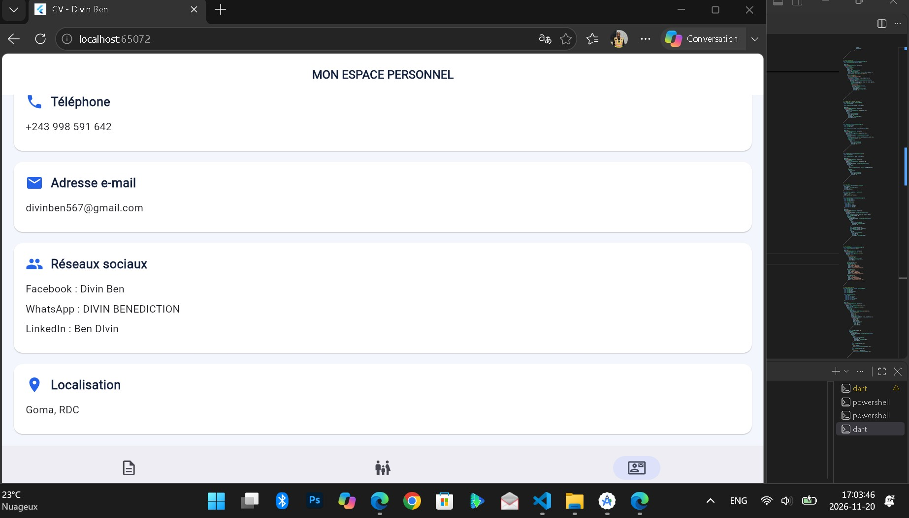
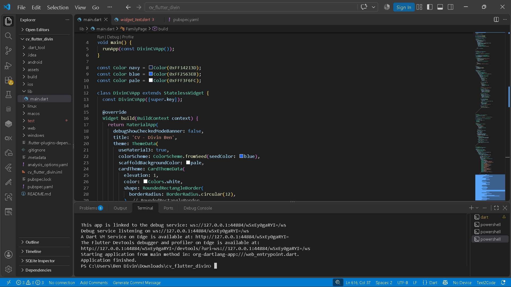

# APPLICATION CV – DIVIN BEN

## Présentation du projet

Bienvenue sur mon projet Flutter de présentation personnelle.

Cette application permet de découvrir mon curriculum vitæ, mes informations personnelles, ma famille ainsi que mes coordonnées.

## Fonctionnalités

- Présentation personnelle
- Consultation de mon CV
- Présentation des membres de ma famille
- Affichage des photos familiales
- Informations de contact
- Interface moderne et navigation simple

##  Technologies utilisées

- Flutter
- Dart
- Visual Studio Code
- Git et GitHub

## Captures d'écran

### Capture 1

### Capture 2

### Capture 3

### Capture 4

### video demo 
[voir ma video](https://drive.google.com/file/d/18WYdZe_0bBQCtOQYLJPKGjd-1WFHSL1M/view?usp=sharing)
## Auteur

**DIVIN BAHAVU BÉNÉDICTION**

Étudiant en Licence 4

## 🔗 Lien du projet

[Voir mon projet sur GitHub](https://github.com/Divin-Ben/cv_flutter_divin)

---

© 2026 DIVIN BEN – Tous droits réservés.
